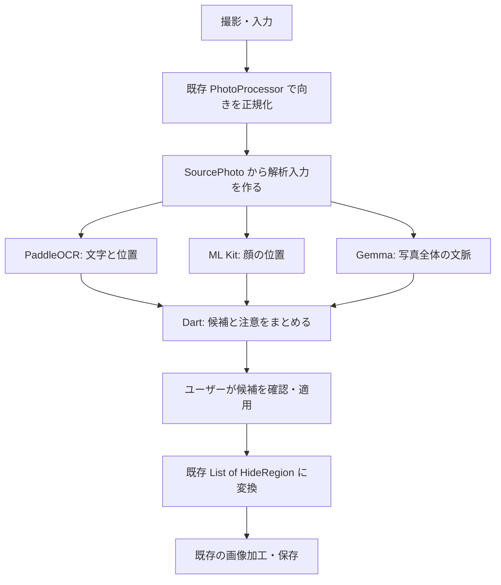

# 撮影後のオンデバイス解析の設計案

2026-10-27の更新: [実写3枚での検出評価](detector-evaluation.md)と[Android組み込み](android-detectors.md)を実施した。MVPではVLMを必須にせず、範囲候補を優先する。通常フローはYOLOの人物・画面とPP-OCRv5の文字検出を使い、Gemma検証コードは保持する。画面全体の候補は有用だが、小さな写真・書類の見落としが残る。以下は2026-10-20時点の設計案として残す。

作成日: 2026-10-20。状態: 設計案と単独検証。本体組み込みは #28 で進める。

進め方の更新: Gemma の画像入力検証を [#23](https://github.com/camereon-dev/camereon/issues/23) で先行する。
リスク評価は、実際の認識結果と失敗例を材料に深く検討する [後続タスク #24](https://github.com/camereon-dev/camereon/issues/24) に分ける。
以下のリスク判定の項目は設計上の論点であり、今回の検証で実装・確定するルールではない。
ユーザーの方針に従い、VLM は Gemma 3n から Gemma 4 E2B へ変更した。

## 1. 今回の目的

撮影した写真から、隠した方がよい可能性のある文字や顔を見つけ、理由とともに候補として提示する。
チームが進めている編集・加工・保存と並行して、まず Android で PaddleOCR と Gemma 4 E2B をそれぞれ単独実行する。
モデルが読み込めるだけでなく、実際の画像を入力して内容に応じた結果が返るところまで確認する。

既存の手動 MVP に解析を接続する次段階の設計とする。自動解析の完了を待たずに、手動編集・保存の開発を進められるようにする。
実施済みの単独検証は [VLM の記録](gemma-evaluation.md) と [OCR の記録](ocr-evaluation.md) に残す。実機計測とアプリ本体への組み込みは後続とする。

## 2. 採用する構成と、検証前に分かっていること

| 用途 | 採用技術・第一候補 | 役割と条件 |
| --- | --- | --- |
| UI・カメラ | Flutter / Dart | Android から開始。画面は解析エンジンを直接呼ばず、解析サービスの状態と候補を表示する |
| OCR | PaddleOCR PP-OCRv6 small | 文字領域・認識文字列・認識スコアを取得する。日本語・英語・混在画像を評価する |
| VLM | Gemma 4 E2B、画像対応の `.litertlm`。SmolVLM2 500M を軽量比較候補とする | 写真全体の状況や、写り込みの文脈を補足する |
| VLM 推論 | LiteRT-LM。`flutter_gemma` 系の Flutter ラッパーを優先検証 | 現在の後継名は `flutter_edge_ai` + `flutter_edge_ai_litertlm`。旧名と新名の API を混ぜず、検証した組み合わせを固定する |
| 顔検出 | ML Kit Face Detection | 顔の位置を取得する。人物の特定や本人判定は行わない。オフライン利用のため同梱モデルを優先する |
| リスク判定 | Dart | OCR・顔・VLM の結果を共通形式にまとめ、理由付きの候補と画像全体への注意を生成する |
| 画像編集 | 既存の Flutter UI と `PhotoProcessor` | ユーザーが適用した範囲を既存の編集処理へ渡す。黒塗り・ぼかし・書き出しの実装方式は画像処理側が扱う |

### 対応 OS とモデルサイズ

- 組み込み前の本体は API 24 以上。今回の組み込みブランチは API 30 以上。既存の PaddleOCR Android SDK 評価は API 26 以上なので、そのまま本体に依存を追加すると対応範囲が変わる。[既存検証](ocr-evaluation.md)、[PaddleOCR の Android 要件](https://github.com/PaddlePaddle/PaddleOCR/blob/main/docs/version3.x/inference_deployment/cross_platform/android_deployment.en.md)
- `flutter_gemma` は旧名での公開を終了し、後継への移行が案内されている。現在の後継パッケージの LiteRT 系ランタイムは Android API 30 以上・ARM64 を要求する。[旧パッケージの案内](https://pub.dev/packages/flutter_gemma)、[後継のプラットフォーム要件](https://pub.dev/packages/flutter_edge_ai)
- 検証用に `flutter_edge_ai 2.4.1` + `flutter_edge_ai_litertlm 1.15.0` を固定。独立した評価アプリで Android ARM64 エミュレーター上の Gemma 4 / SmolVLM2 のモデルロード・画像推論まで確認。実機の性能は未確認。[検証状況・他モデルの比較方針](gemma-evaluation.md)、[パッケージの導入例](https://pub.dev/packages/flutter_edge_ai)
- Gemma 4 の native 用 `gemma-4-E2B-it.litertlm` を約 2.59 GB で固定。Web 用・別の変換版と取り違えない。ダウンロード容量と実行時 RAM は別に計測する。[配布ファイル](https://huggingface.co/litert-community/gemma-4-E2B-it-litert-lm/tree/main)

単独検証は評価アプリを分けた。本体組み込み #28 では SDK の要件に合わせ API 30 へ引き上げる。 API 判定の `if` を Dart に書くだけでは、依存ライブラリの `minSdk` 要件を回避できない。
本体では ARM64 のときだけ AI を初期化し、それ以外の ABI では解析を利用不可として表示する。ネイティブ直結なら API 24 を維持できる、とは現時点で判断しない。

## 3. 全体構成



最初の単独検証では OCR と VLM を互いに接続しない。VLM に OCR の文字だけを渡すのではなく、画像そのものを入力した解析の成立を確認する。
統合後は OCR 結果を VLM に補足情報として渡してもよいが、画像入力は継続する。

### 層ごとの責任

| 層 | 持つもの | 他の層への依存 |
| --- | --- | --- |
| 画面 | 撮影後の進捗、候補の枠、候補の適用・解除、注意文 | 解析サービスと共通データ型。Paddle・Gemma・ML Kit の API は参照しない |
| 解析の進行管理 | 実行順、写真ごとの処理 ID、キャンセル、部分結果、エラーの集約 | OCR・VLM・顔検出・モデル管理のインターフェース |
| ドメイン | OCR 結果、顔の範囲、文脈情報、リスク判定ルール | Dart のデータ型。Widget やプラグイン固有クラスを持ち込まない |
| 各エンジンのアダプター | 画像の前処理、SDK 呼び出し、座標の復元、結果の変換、リソース解放 | 各 SDK と共通インターフェース |
| モデル管理 | 入手・検証・配置、準備状態、バージョン、削除 | モデルファイル。写真や OCR 内容を保存する責務は持たない |

配置案:

```text
lib/core/analysis/
  domain/          # 入出力の型、リスク判定。プラグインに依存しない
  application/     # 進行管理、部分結果、キャンセル
  infrastructure/  # paddle / litert_lm / mlkit / model_store
lib/features/analysis/
  ...              # 進捗・候補の表示と既存編集画面への接続
tools/ocr-eval/    # 既存の独立した Android OCR 評価
tools/vlm-eval/    # 独立した Flutter/Android の画像解析評価
```

iOS 対応時はネイティブ SDK とモデルの実行可否を別途確認し、アダプターを追加する。VLM を変える場合も、画面とリスク判定側に SDK の型を広げない。
インターフェースを揃えても、別 OS・別モデルの速度、機能、メモリ使用量まで同じになるとは限らない。

## 4. チームと共有する入出力

既存の [`SourcePhoto`・`HideRegion`](../lib/core/photo/) の画像サイズ・座標の約束を維持する。
解析側では純粋なデータ型を使い、境界で変換する。以下は型の設計案であり、実装済み API ではない。

| 型 | 主な内容 |
| --- | --- |
| `AnalysisImage` | セッション内の `photoId`、正規化済み画像のバイト列、画素幅・高さ。`SourcePhoto` から作り、不要な画像コピーは避ける |
| `OcrBlock` | `blockId`、文字列、四隅の座標、認識スコア。すべて正規化済み画像の座標で返す |
| `DetectedFace` | `faceId` と範囲。表情の確率を顔検出の確信度として流用しない |
| `SceneContext` | 写真の状況、確認した方がよい種類の情報、参照する `blockId`、解析上の制約 |
| `RiskCandidate` | ID、写真 ID、種類、範囲、根拠となるブロック・エンジン、表示する理由、ルール上の優先度 |
| `ReviewNotice` | 範囲を特定できない注意。例: 「背景の画面や書類も確認してください」 |
| `StageResult<T>` | 成功・失敗・未導入・未対応・キャンセルの区別と、成功時の結果、処理時間、使用モデル情報 |
| `AnalysisReport` | OCR・顔・VLM それぞれの状態、候補、注意。途中結果も通知できる |

エンジンの境界は、概念として次の形にする。

```text
OcrEngine.recognize(AnalysisImage)        → StageResult<List<OcrBlock>>
FaceDetector.detect(AnalysisImage)        → StageResult<List<DetectedFace>>
SceneAnalyzer.analyze(AnalysisImage, ...) → StageResult<SceneContext>
RiskAssessor.assess(集めた結果, Policy)   → 候補 + 注意
PhotoAnalysisService                    → 進捗 + 部分的な AnalysisReport
```

### 座標の約束

1. 入力は EXIF の向きが画素に反映された画像。各 SDK が再び回転・左右反転しないようにする。前面カメラの表示上のミラーと画像データの座標も区別する。
2. 各エンジンで縮小・余白追加・切り出しを行った場合は、その変換を保持し、結果を元の正規化済み画像の座標に戻す。OCR の四隅をすべて変換する。
3. OCR の四角形と顔の範囲から、適用時に外接長方形を作る。必要な余白は判定ルールとして明示し、画像内に切り取る。
4. 既存の `HideRegion.fromRect` で外側への丸めと範囲の制限を行う。これ以降は手動選択と同じ加工・保存経路に渡す。
5. 候補を適用した範囲は通常の編集状態に追加する。解析の再実行で、手動選択や適用済みの範囲を消さない。

## 5. 各エンジンとリスク判定の役割

### OCR: 文字と位置

PP-OCRv6 small の検出・認識・辞書の組み合わせを固定する。日本語・英語と数字、混在行を同じ評価画像で確認する。
日本語は既存のエミュレーター検証があるが、実機速度と英語・混在画像の成立は改めて確認する。
アダプターはまず既存の Kotlin/ONNX Runtime 評価を再利用する案を優先し、Flutter とは Pigeon または MethodChannel で接続する。
最初から Dart 側に OCR の前処理・後処理を移植し直さない。

### 顔検出: 顔の位置

ML Kit Face Detection の同梱モデルを優先する。配布方式によっては初回のモデル取得が必要になるため、インストール後のオフライン要件と整合させる。[ML Kit の配布方式](https://developers.google.com/ml-kit/vision/face-detection/android)
初期設定ではランドマーク・表情分類などを有効にせず、顔の範囲を候補にするための情報を取得する。

### VLM: 写真全体の文脈

Gemma には「この写真には何が写っていて、公開前に何を確認すべきか」を問い合わせる。
統合時は OCR ブロックに ID を付けて渡し、「名札の名前」「郵便物の住所」などの説明を既存ブロックに対応させる案とする。
VLM が独自に返した座標や、画像にない文字列をそのまま黒塗りに使わない。対応する検出範囲がない内容は `ReviewNotice` にする。

構造化出力は、状況・情報の種類・`blockId` の列挙など、小さな JSON スキーマを要求する案とする。
正しい JSON が必ず返るとは仮定せず、パース、型、列挙値、ブロック ID の存在、出力長を検証する。失敗時に自由文から座標を推測して補わない。
画像内や OCR 内に書かれた指示は解析対象のデータとして扱い、ツール実行や外部通信の指示として扱わない。

### Dart: 候補と注意への統合

- メールアドレス・電話番号などは、OCR 文字列に対するルールで候補にする。正規表現だけで人名・住所を完全判定できるとは扱わない。
- 顔は顔検出の範囲を候補にする。住所・名札などは OCR の範囲と VLM の文脈を組み合わせて説明を補う。
- VLM が「問題なし」と返しても、OCR・顔検出ですでに得た候補を消さない。
- VLM の自己申告の確信度、OCR の認識スコア、ルール上の優先度を同じ数値として足し合わせない。
- 重複した候補には根拠をまとめるが、隣の領域まで広く隠す統合は安易に行わない。認識できなかった箇所や低スコアの文字もユーザーが確認できるようにする。
- AI の結果は候補として提示し、ユーザーが適用する。自動検出で安全を完全に保証する表示はしない。

## 6. 進行管理とモデルの扱い

### 実行の流れ

1. 撮影後の正規化済み画像に処理 ID を付ける。各処理はこの ID を結果に付ける。
2. まず OCR と顔検出を実行し、できた候補から表示する。初期実装はメモリ使用量を把握しやすい直列実行を基本とし、実測後に並列化を判断する。
3. VLM が準備済みで対応端末なら、同じ画像で文脈解析を追加する。OCR・顔のモデルを解放してから VLM をロードする構成も評価する。
4. VLM が失敗・未導入でも OCR・顔の結果と手動編集を利用できるようにする。
5. 撮り直し・画面離脱時はキャンセルする。ネイティブで中断できない処理も、古い処理 ID の結果を次の写真に適用しない。

「成功して候補が 0 件」と「未実行・未導入・失敗」を区別し、画面に各処理の状態を示す。
モデルのロードはカメラ起動を待たせず、ユーザーが編集を始められるようにする。
`Future` にするだけで重い処理が UI スレッドから離れるとは扱わない。各アダプターで、画像処理・推論・モデル初期化を適切なバックグラウンド実行にする。
LiteRT-LM もエンジン初期化をバックグラウンドで行うよう案内している。[Android API の初期化と画像入力](https://developers.google.com/edge/litert-lm/android)

### モデルの入手と寿命

- 単独検証は担当者が取得したモデルを `adb` などで端末へ置く。検証用の APK に数 GB のモデルを含めない。
- 今回固定した Gemma 4 / SmolVLM2 は認証不要の公開配布で、配布メタデータのライセンスは Apache-2.0。取得元・ライセンス・リビジョンを記録し、本体でのモデル配布方法は別途決める。[Gemma 4 の配布](https://huggingface.co/litert-community/gemma-4-E2B-it-litert-lm)、[SmolVLM2 の配布](https://huggingface.co/litert-community/SmolVLM2-500M)
- 本体への導入では、必要容量・利用条件・取得状況を示してからモデルを取得する案とする。Hugging Face の共有トークンを APK や `dart-define` に埋め込んで配布しない。
- モデル・辞書・SDK のバージョンと SHA-256、入力解像度、量子化方式、バックエンド、プロンプト版を記録する。
- 取得・検証が完了したファイルだけを利用する。途中ファイルや破損したモデルを「準備済み」にしない。
- インストール後のオフライン利用にはモデルの準備が必要であることを示す。未導入時にクラウド推論へ自動で切り替えない。
- 初期案では VLM の同時実行を 1 件に制限し、会話状態を写真ごとにリセットする。モデル・会話・画像バッファーの解放を行い、連続撮影でメモリが増え続けないことを確認する。
- 通常利用の写真、OCR の全文、VLM の全文を永続ログに残さない。評価記録には架空情報の画像を使う。

## 7. 最初に行う Android 単独検証

OCR と VLM は並行して検証できる。編集・保存の実装完了は前提にしない。
既存の実機確認に使った Xiaomi 14T Pro を第一候補とし、実際の OS・RAM・GPU・空き容量を開始時に記録する。別端末を使う場合も同じ項目を残す。

### A. PaddleOCR small 単独

既存の [`tools/ocr-eval/`](../tools/ocr-eval/README.md) を再利用する。PP-OCRv6 small を対象に、実機と日英の画像を追加して確認する。
既存評価の OpenCV 4.10.0 への差し替えも引き継ぎ、Android の実機で読み込めるか確認する。

```sh
ANDROID_SERIAL=<device-id> bash tools/ocr-eval/run.sh
```

このスクリプトは既存の評価を実行するもので、日英の追加画像やアプリ連携は別途追加する必要がある。

完了条件:

- [ ] Android 実機で small の検出・認識モデルと辞書をロードできる。
- [ ] 日本語、英語、日英混在の画像から文字列と位置を取得できる。正解との違い・見落としも記録する。
- [ ] 文字のない画像では結果を確認し、誤検出の有無を記録する。
- [ ] 縦・横、縮小ありの入力で、返した範囲を元画像に重ねて位置を目視できる。
- [ ] モデル配置後にネットワークを切って同じ画像を処理できる。
- [ ] 初回ロード、検出・認識時間、繰り返し実行、メモリ、APK・モデル容量を記録する。
- [ ] 他メンバーが手順と同じモデルで再現できる。

### B. Gemma 4 E2B / SmolVLM2 単独

`tools/vlm-eval/` に API 30 以上・ARM64 の独立した Flutter 評価アプリを用意した。エミュレーターでの実施結果は [検証記録](gemma-evaluation.md) を参照する。以下の完了条件には実機での採用確認を含む。
本体と異なる applicationId を使い、本体の `pubspec.yaml`・Android 設定や担当中の画面を変更しない。

1. `flutter_gemma` 系の現行後継と LiteRT-LM の組み合わせを固定する。
2. 公式の画像対応 `.litertlm` ファイルを取得・配置し、モデルロードを確認する。
3. 画像だけが異なる 2 枚以上に、同じ短い質問を投げる。画像を本当に読み取っているかを確認する。
4. 「写っているもの」を返す。成立確認の後は、固定した OCR 文字列を補足した場合の文脈理解も比較する。リスクの判定は後続 #24 で扱う。
5. 画像入力が失敗した場合は、同一モデル・同一画像を公式 Kotlin LiteRT-LM API で実行し、ラッパーとモデル／端末の問題を切り分ける。[LiteRT-LM の画像入力](https://developers.google.com/edge/litert-lm/android)

完了条件:

- [ ] Android 実機で、対象モデル・LiteRT-LM・画像入力に使うバックエンドを特定できる。
- [ ] テキストだけの応答ではなく、実際の画像を渡して内容に応じた説明が得られる。
- [ ] 同じ質問で画像を変えると、異なる内容に対応した出力が得られる。画像なしの対照実行とも比較する。
- [ ] 名札・郵便物・画面などの画像で、文脈の説明と誤り・見落としを記録する。
- [ ] モデル配置後はオフラインで動く。
- [ ] 初回ロード、画像前処理、最初の出力まで・完了までの時間、メモリ、端末の発熱や連続実行時の変化を記録する。
- [ ] 不正な出力、メモリ不足、キャンセル、画像非対応・バックエンド非対応を区別できる。
- [ ] モデルの取得条件を含め、他メンバーが再現できる手順を残す。

「動作した」と「採用してよい速度・精度・対応端末である」は分けて記録する。速度の合格基準は実機の結果を見て決め、エミュレーターの計測値で保証しない。

### 共通の評価画像と記録

架空の日本語・英語の名札、日英混在の宛名、画面や書類の写り込み、同意を得た顔、個人情報のない風景を用意する。
情報が写る画像と写らない画像の両方を使い、可能なら同じ背景の比較画像も用意する。画像の利用条件と正解の範囲を記録する。
実機で撮影した写真も加えるが、実在の個人情報は公開しない。

記録項目は、対象コミット・端末・OS・RAM・モデル識別子とハッシュ・バックエンド・画像 ID・入力サイズ・プロンプト・初回／準備済みの状態・実行時間・メモリ・結果・制約。
評価用の架空データでは全文出力も保存できるが、通常の撮影画像のログ出力には持ち込まない。

## 8. 単独動作の後に行うこと

| 順序 | 作業 | 着手の条件・完了時に渡すもの |
| --- | --- | --- |
| 並行 A | OCR の実機・日英検証 | 既存評価を再利用。認識結果、範囲、実機の計測、SDK・モデルの固定情報 |
| 並行 B | VLM の実機画像入力検証 | 独立評価アプリ。Flutter ラッパーの採否、モデル取得手順、画像入力・リソースの記録 |
| 並行 C | ML Kit の顔候補 | 同梱モデルと座標変換。写真への範囲の重ね合わせ |
| 並行 D | 認識結果・失敗状態の共通データ型 | A〜C の生の結果を受け渡す契約。リスク評価ルールは含めない |
| A〜C の結果が集まった後 | リスク評価の仕様・評価データ・統合ルール（#24） | 対象カテゴリ、見落とし・過検知の評価、根拠と位置、不明・失敗の扱いを決める |
| A・B の後 | 解析 SDK の共存確認 | ONNX Runtime・OpenCV・LiteRT-LM・ML Kit を同じプロセスに入れ、ビルド・ネイティブライブラリ・メモリ・連続実行を確認する |
| 検証結果の後 | 本体の対応条件とモデル配布を確定 | 最低 OS、必要な端末条件、モデルの導入方法、容量と利用条件の説明 |
| 編集側との結合 | 撮影後の候補提示・適用 | `SourcePhoto` を受け、適用候補だけを `HideRegion` に変換。位置一致、取り消し、保存、失敗時の手動操作を実機で確認する |

単独で動いたことだけでは、複数 SDK の共存や本体への統合が成立したことにはしない。
既存の #13（顔検出）は顔のアダプターと UI 接続に対応する。#14 は現在「文字内容の認識を含めない」範囲なので、今回の small による認識・VLM の単独検証・Dart の判定は、追加 Issue として分けるか本文を更新して範囲を揃える。

## 9. チームへ最初に渡すもの

1. この設計と共通の入出力案。解析サービスの実装がなくても編集側を進められることを共有する。
2. A・B の評価担当と実機、モデル取得担当。編集・保存側の共有ファイルは単独検証で変更しない。
3. 評価画像と正解、モデル・パッケージの固定情報、再現手順。
4. 検証後に判断する事項: 最低 OS、対応端末、待ち時間、モデル配布、UI への接続方法。

初期の採用方針は、**文字・顔の位置を検出結果から得て、VLM で文脈を補い、Dart で候補をまとめ、ユーザーが適用する**こと。
AI 側が写真を自動で確定加工せず、既存の手動編集と同じ加工・保存経路を使う。
